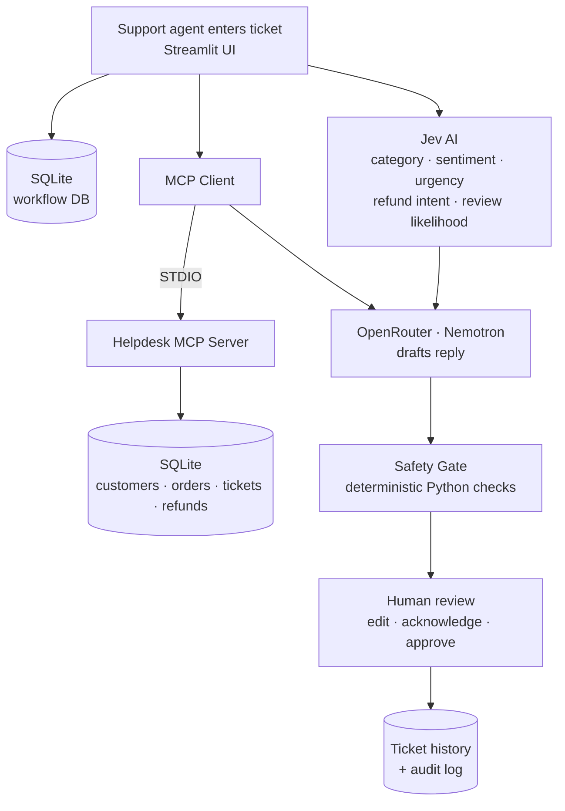

# 🎫 TicketPilot

**An AI-assisted customer support workflow with a human always in the loop.**

TicketPilot helps a support team understand a complaint, pull the right customer and order records, draft a reply, and check that draft for mistakes before a human approves and closes the ticket.

It is not a chatbot and it is not a fully autonomous agent. It is a structured, auditable workflow where each component does one job.


---

## Why this project exists

An e-commerce support team handles hundreds of tickets a day: damaged products, late deliveries, missing orders, refund problems, defective items. For each one, an agent has to:

1. Read and understand the complaint
2. Look up the customer
3. Check order and refund records
4. Write a reply
5. Decide whether the issue is resolved

That is slow and easy to get wrong. TicketPilot automates the repetitive parts (analysis, lookup, drafting, consistency checks) and leaves the decision to a person.

---

## How it works

TicketPilot combines three different AI-related components. They are not interchangeable.

| Component | Role |
|---|---|
| **Jev AI** | Decision assessment: category, sentiment, urgency, refund intent, human-review likelihood |
| **MCP (Model Context Protocol)** | Standard interface that lets the app read customer, order and refund data from the helpdesk database |
| **LLM via OpenRouter (NVIDIA Nemotron)** | Writes a natural-language reply draft from the ticket, the Jev assessment and the MCP records |

A deterministic Python **Safety Gate** then checks the draft, and a **human agent** makes the final call.

### Architecture



### The workflow, step by step

1. **Ticket creation.** The agent fills in subject, customer name and email, reported category, order ID, amount and message. The ticket is stored in SQLite with a generated workflow ID.
2. **Jev review.** The ticket is sent to the Jev API, which answers five questions using three answer types:
   - *choice* picks a ticket category
   - *score* rates customer sentiment and urgency
   - *noul* gives a 0 to 1 likelihood for refund intent and for needing human review
3. **MCP lookup.** The app's MCP client launches the helpdesk MCP server over STDIO and calls read-only tools to fetch the customer, their orders, the specific order and its refund history.
4. **Reply drafting.** The ticket, Jev assessment and MCP records go to Nemotron through OpenRouter. The system prompt forbids inventing data or claiming actions (like a processed refund) that the records do not support.
5. **Safety Gate.** Plain Python checks look for inconsistencies (see below).
6. **Human approval.** The agent reads the draft, edits it, acknowledges any findings, and clicks **Approve & Close Ticket**.
7. **History.** The approved reply, safety findings, timestamps and audit events are saved.

---

## Features

- Structured ticket assessment through the Jev decisions API
- MCP client and server with five read-only helpdesk tools
- LLM-drafted replies grounded in real records
- Deterministic Safety Gate (no second LLM involved)
- Human-in-the-loop approval; nothing closes automatically
- Ticket history and audit log in SQLite
- Fully fictional seed data, so it is safe to run and demo

### MCP tools

| Tool | What it returns |
|---|---|
| `get_customer` | Customer details by customer ID or email |
| `get_order` | A specific order |
| `get_customer_orders` | All orders belonging to a customer |
| `get_ticket` | An existing helpdesk ticket |
| `get_refund_history` | Refund records for an order |

All tools are **read-only**. TicketPilot cannot issue refunds or modify orders.

### Safety Gate checks

- Does the email match a customer record?
- Does the customer name match the retrieved customer?
- Does the order ID exist?
- Does the order belong to the matched customer?
- Does the reply claim a refund was completed without a refund record?
- Does the reply claim a replacement shipped without a supporting record?
- Is the reply complete enough to send?

The gate **flags** problems; it does not block closure. The human can review a finding, acknowledge it, and still approve. This is deliberate: the person stays accountable.

---

## Getting started

### Prerequisites

- Python 3.10+
- A **Jev API key**
- An **OpenRouter API key**

### Installation

```bash
git clone https://github.com/<your-username>/TicketPilot.git
cd TicketPilot

python -m venv venv
source venv/bin/activate        # Windows: venv\Scripts\activate

pip install -r requirements.txt
```

### Configuration

Copy the example environment file and fill in your keys:

```bash
cp .env.example .env
```

```env
JEV_API_KEY=your_jev_key
OPENROUTER_API_KEY=your_openrouter_key
OPENROUTER_MODEL=your_nemotron_model_id
```

> ⚠️ Never commit `.env`. Make sure it is listed in `.gitignore`.

### Seed the database

```bash
python -m database.seed_data
```

This creates the fictional customers, orders, tickets and refunds.

### Run the app

```bash
streamlit run app.py
```

Open the URL Streamlit prints (usually `http://localhost:8501`).

---

## Try it

Use the seeded demo data to see the full flow:

| Field | Value |
|---|---|
| Subject | Wireless headphones arrived damaged |
| Customer name | Aarav Demo |
| Customer email | aarav.demo@example.test |
| Category | Damaged / Defective |
| Order ID | ORD-2026-10452 |
| Amount | 2499.00 |
| Message | I received my wireless headphones, but the left earcup is broken. I would like a replacement or a full refund. |

To see the Safety Gate fire, submit the same order ID with a different customer (for example, `mira.sample@example.test`). The gate will report that the order belongs to someone else.

---

## Project structure

```
TicketPilot/
├── app.py                      # Streamlit UI and workflow orchestration
├── mcp_client.py               # Connects to the MCP server, invokes tools
├── helpdesk_server.py          # MCP server entry point
├── mcp_servers/
│   ├── __init__.py
│   └── helpdesk_server.py      # MCP server implementation
├── database/
│   ├── __init__.py
│   ├── db.py                   # SQLite connection and access
│   ├── schema.sql              # Table definitions
│   └── seed_data.py            # Fictional test data
├── requirements.txt
├── .env.example
└── README.md
```

### Database

- **Helpdesk tables** (customers, orders, tickets, refunds): seeded test records that the MCP server reads.
- **Workflow tables** (`ticketpilot_workflow`, `ticketpilot_audit`): created by TicketPilot to store closed tickets, approved replies, safety findings and audit events. These are separate from the seed tickets.

---

## Design decisions

**Why separate Jev and the LLM?** Jev returns structured, typed assessments the app can act on. The LLM writes language. Keeping them apart makes each easier to test and replace.

**Why MCP instead of letting the LLM query the database?** MCP keeps data access behind a standard tool interface. The LLM never touches the database; it only sees what the app retrieves. SQLite can later be swapped for another backend without changing the app.

**Why application-orchestrated MCP?** The Streamlit app decides which tools to call, not the LLM. That gives predictable, auditable data access. The trade-off is that this is a workflow, not an autonomous agent.

**Why a non-AI Safety Gate?** Rule-based checks are deterministic and easy to explain. They catch known failure modes, though they are not a guarantee against every incorrect statement.

---

## Limitations

TicketPilot is a prototype. It does **not**:

- Send emails or replies to customers
- Issue refunds or ship replacements
- Update order status in any e-commerce platform
- Connect to a real CRM or production database
- Include a company policy engine

The Safety Gate only covers the checks listed above.

## Roadmap

- [ ] Send approved replies via Gmail or another messaging service
- [ ] Connect a real e-commerce database or CRM
- [ ] Policy knowledge base with RAG
- [ ] Priority queues and agent assignment
- [ ] Analytics: resolution time, categories, sentiment trends
- [ ] Role-based access for agents and admins

---

## Tech stack

Python · Streamlit · Jev AI API · MCP SDK · SQLite · OpenRouter · NVIDIA Nemotron · Requests · python-dotenv

## Disclaimer

All customer, order and refund data in this repository is fictional and for demonstration only.

## License

Add a license of your choice (MIT is a common default).
